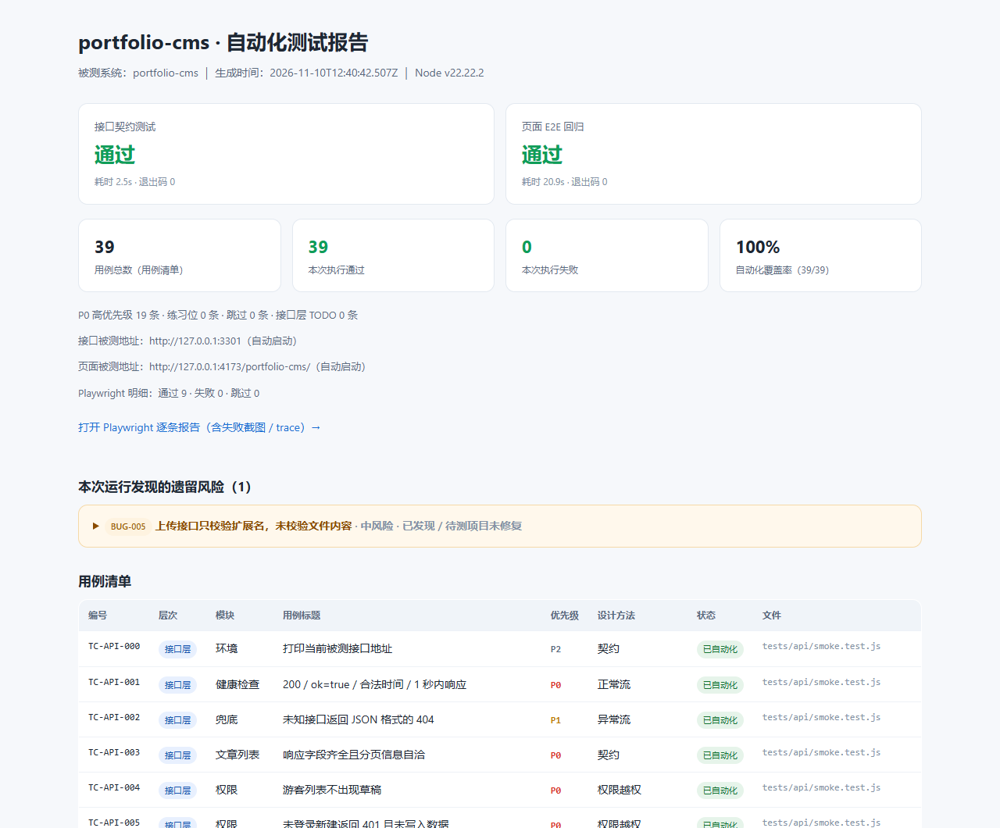

# portfolio-cms-qa

> [portfolio-cms](https://github.com/Morris8088/portfolio-cms) 的**配套自动化测试工程**。
> 一句话：它不写业务代码，只负责"把被测系统拉起来、按设计好的用例测一遍、出一份能给人看的报告"。

## 当前成绩

| 层次 | 用例数 | 本次结果 | 耗时 |
| --- | --- | --- | --- |
| 接口契约（Node 内置 `node:test`） | 30 | 30 通过 / 0 失败 | ~2 秒 |
| 页面 E2E（Playwright + 系统 Chrome） | 9 | 9 通过 / 0 失败 | ~20 秒 |
| **合计** | **39** | **39 通过 / 0 失败 / 0 TODO / 0 跳过** | **~25 秒** |

`cases/testcases.json` 里 39 条用例**全部是 `automated`**，没有练习位、没有跳过、没有伪装成通过的空壳。
报告首屏的「本次执行通过 39」不是手填的：接口层来自 TAP 的 `# pass 30`，页面层来自 Playwright JSON reporter 的 `stats.expected`。

> ⚠️ **全部通过 ≠ 没有缺陷**。跑这套用例时新发现 1 个被测项目尚未修复的风险：
> `BUG-005` 上传接口只校验扩展名、不校验文件内容（把脚本改名成 `.png` 能传上去）。
> 我**故意没把它写成失败断言**，而是记录进 `cases/testcases.json` 的 `knownIssues` 和 `docs/03-缺陷清单.md`，
> 报告里有一块可展开的「遗留风险」。理由见 `docs/02` 第五节 —— 把缺陷固化成"期望值"是测试设计的反模式。

## 为什么要单独建一个仓库

原来那个项目里其实已经有 60+ 个测试，但都散在 `backend/test/`、`frontend/test/` 和脚本里。
面试官打开仓库，看到的是一堆 `.test.js`，看不出**你懂不懂测试设计**。

单独拆出来的好处：

| 求职方向 | 这个仓库能拿出来讲的东西 |
| --- | --- |
| 测试 | 39 条用例的设计方法、分层策略、5 个缺陷、数据隔离、CI、可视化报告 |
| 前端 | Playwright 页面自动化、选择器设计、hash 路由与 SPA 兜底、回归用例 |
| 后端 | 接口契约、鉴权与越权、参数边界、上传安全、`node:test` 零依赖方案 |

同一份代码，三个岗位各讲各的重点，不用准备三套作品。

## 快速开始

**前置条件**（一次性）：

1. Node ≥ 22
2. 机器上装了 Google Chrome（Windows 默认路径 `C:/Program Files/Google/Chrome/Application/chrome.exe`）
3. 被测项目 `portfolio-cms` 在本仓库的**隔壁目录**，并且：
   - `backend/`、`frontend/` 都跑过 `npm install`
   - `frontend/` 跑过 `npm run build:demo`（页面测试要用 `dist` 产物）

```bash
npm install      # 只装 @playwright/test，不下载浏览器
npm test         # 一键：接口层 + 页面层 + 生成报告
```

跑完打开 **`reports/index.html`** —— 这份报告可以直接发给面试官。



也可以分层跑：

```bash
npm run test:api   # 只跑接口契约（自动起停真实后端）
npm run test:e2e   # 只跑页面 E2E（自动起停本地静态站点）
npm run report     # 只重新生成报告
```

### 想测线上站点而不是本地？

```bash
E2E_BASE_URL=https://morris8088.github.io/portfolio-cms/ npm run test:e2e
```

设了 `E2E_BASE_URL` 之后，Playwright 不会再启动本地静态服务器，直接打你给的地址。
（国内访问 GitHub Pages 偏慢，日常回归建议用默认的本地靶子；线上地址用于发版后抽查。）

## 目录结构

```
portfolio-cms-qa/
├── cases/testcases.json      用例清单——唯一数据源（含 knownIssues 遗留风险）
├── docs/                     策略 / 用例设计 / 缺陷清单 / 面试讲法 / 精读与扩展
├── fixtures/factory.js       测试数据工厂（每次造新数据，避免用例互相污染）
├── scripts/
│   ├── sut-server.mjs        用内存库启动真实后端，跑完即焚
│   ├── static-server.mjs     本地复刻 GitHub Pages（含 SPA 兜底）
│   ├── with-sut.mjs          起服务 → 跑测试 → 一定关服务（含测试发现）
│   ├── run-all.mjs           两层都跑完，解析 TAP/JSON 统计，再统一出报告
│   └── make-report.mjs       汇总成 reports/index.html
├── tests/
│   ├── api/                  接口契约层（30 条，Node 内置 test runner，零依赖）
│   │   ├── helpers/client.js    fetch 封装：状态码/响应体/耗时；上传与二进制读取
│   │   ├── smoke.test.js        范例①：7 条冒烟与契约（逐行注释写透）
│   │   ├── auth.test.js         登录 / 账号枚举 / 伪造令牌（5 条）
│   │   ├── posts.crud.test.js   新建、校验、409、部分更新、草稿可见性、删除（6 条）
│   │   ├── posts.query.test.js  搜索、标签、排序、注入、分页（6 条）
│   │   └── uploads.test.js      上传安全专场（6 条，含 BUG-005 探针）
│   └── e2e/                  页面层（9 条，Playwright Test）
│       ├── reader.spec.js     范例②：5 条读者主流程（4 个真实线上事故的回归）
│       └── admin.spec.js      4 条后台流程，含"发布→退出→读者可见"跨角色链路
├── playwright.config.js      浏览器、报告、webServer 配置
└── .github/workflows/qa.yml  CI：自动拉被测项目、构建、跑全套、上传报告
```

## 四个设计决定（面试会被问）

**1. 测试不 import 业务代码，只走 HTTP。**
接口测试把 `portfolio-cms` 当成黑盒，通过 `API_BASE_URL` 访问；`sut-server.mjs` 用 `:memory:` 内存库 + 临时上传目录启动它，跑完自动删除。真实 `data.db` 和 `uploads/` 一个字节都不会被碰。

**2. 页面测试默认打本地靶子，不赌外网。**
第一版直接打线上 GitHub Pages，两个用例并发就 `net::ERR_TIMED_OUT` —— 失败原因是网络不是产品，这种"假红"最消耗对测试的信任。现在用 `static-server.mjs` 本地复刻 Pages（剥掉 `/portfolio-cms/` 前缀、未知路径回 `404.html`），离线、秒开、可重复。

**3. 用例清单只有一份，通过数来自运行产物。**
`cases/testcases.json` 是唯一数据源，`make-report.mjs` 直接读它生成表格；而「本次通过多少条」由 `run-all.mjs` 解析 TAP、`make-report.mjs` 读 Playwright JSON 得到。两边分工，避免"文档一张表、代码一套用例、报告第三份"三处对不上。

**4. 发现缺陷不等于让测试变红。**
BUG-005 是真实缺陷，但把它写成 `assert.equal(status, 201)` 相当于宣布"这个 bug 是产品契约"，将来被测项目修好了，测试反而会挂。所以只记录实测值、写清影响与修复建议，让报告如实呈现「39 条全绿 + 1 条遗留风险」。

## 环境变量

| 变量 | 默认值 | 用途 |
| --- | --- | --- |
| `SUT_ROOT` | `../portfolio-cms` | 被测项目根目录 |
| `SUT_DIST` | `../portfolio-cms/frontend/dist` | 页面测试用的构建产物 |
| `SUT_PORT` | `3301` | 后端测试端口（避开开发用的 3001） |
| `API_BASE_URL` | 自动启动的本地后端 | 接口被测地址 |
| `E2E_BASE_URL` | 本地 `4173` 静态站点 | 页面被测地址 |
| `CHROME_PATH` | 系统 Chrome 标准路径 | 换机器时指定 Chrome |
| `E2E_PORT` | `4173` | 本地静态站点端口 |

## 排错

- **`找不到构建产物 .../dist/index.html`** → 去 `portfolio-cms/frontend` 跑 `npm run build:demo`。
- **`[SUT] 启动失败`** → 确认 `SUT_ROOT` 指对了，且 `backend/node_modules` 存在。
- **`page.goto` 超时** → 多半是设了 `E2E_BASE_URL` 打外网；去掉它用本地靶子。
- **端口被占** → 换 `SUT_PORT` / `E2E_PORT`。
- **Windows 上 Chrome 不在默认路径** → 设 `CHROME_PATH`。

## 文档索引

| 文件 | 什么时候看 |
| --- | --- |
| `docs/01-测试策略与分层.md` | 想讲清楚"为什么分这两层" |
| `docs/02-用例设计方法.md` | 想讲清楚"用例是怎么想出来的"、为什么不把缺陷写成断言 |
| `docs/03-缺陷清单.md` | 想讲清楚"测试真的抓到过 bug"（5 条，含新发现的 BUG-005） |
| `docs/04-面试怎么讲.md` | 面试前一晚 |
| `docs/05-练习任务.md` | 想看懂某一行为什么这么断言、以及下一步能做什么 |
